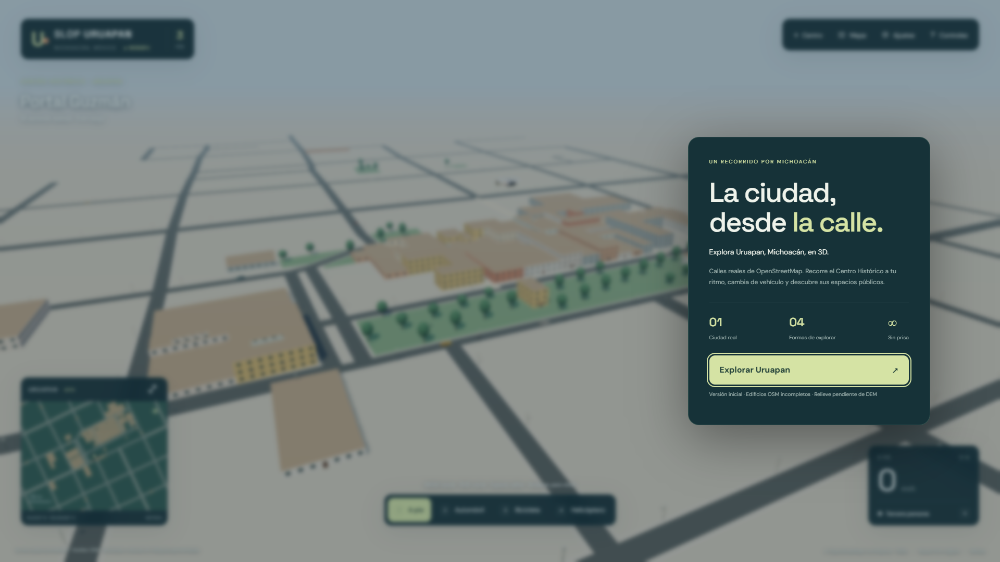
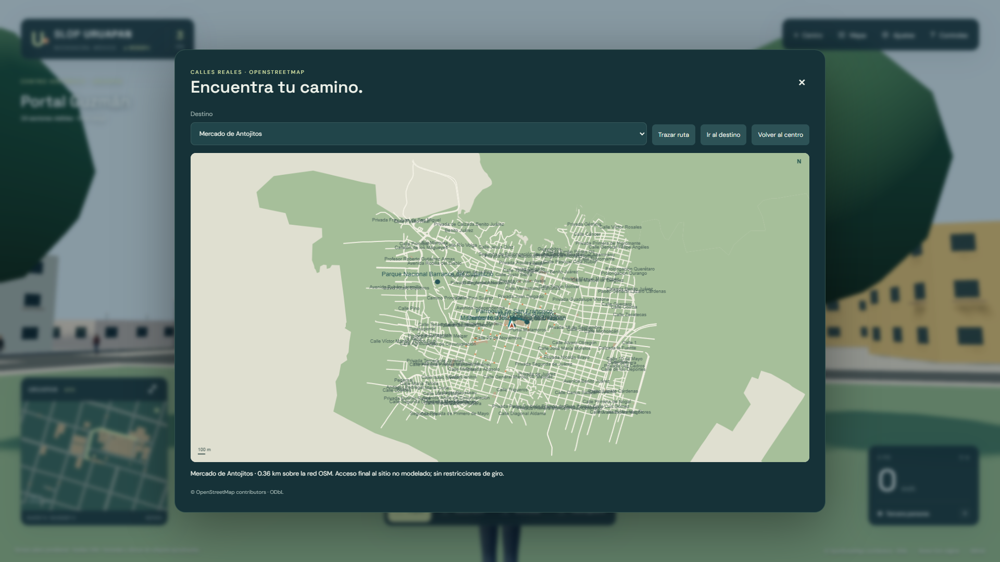

# SLOP URUAPAN

Explora Uruapan, Michoacán, en 3D. Adaptación de [Slop New York de mrdoob](https://github.com/mrdoob/slop-newyork), con calles y huellas reales de OpenStreetMap, sin asumir una cuadrícula.

[**Abrir Uruapan**](https://riantorres1975.github.io/slop-uruapan/) · [Nueva York original](https://riantorres1975.github.io/slop-uruapan/new-york.html) · [Código](https://github.com/riantorres1975/slop-uruapan/tree/feat/uruapan)



## Qué funciona

- Mundo 3D estático servido desde un subdirectorio, con WebGPURenderer y TSL. Fallback WebGL2 probado en Edge.
- Caminar, correr, saltar y gravedad; colisiones con las huellas de edificios, incluyendo huecos.
- Automóvil con aceleración, frenado, dirección y colisiones; entrada/salida con F cerca del vehículo. Bicicleta y helicóptero reutilizados del original.
- Cámaras de seguimiento, exterior baja, primera persona/cabina, aérea y libre. Recuperación al centro con R.
- Minimapa orientado con la cámara, posición, vehículos, calles, sitios OSM, mapa ampliado y rutas sobre grafos reales.
- Tráfico básico sobre aristas dirigidas, separación entre vehículos y reservas de cruces; peatones con el rig del original. Población ajustada según rendimiento.
- Sectores de 240 m con carga y descarga, cancelación de solicitudes fuera del radio, liberación de geometrías e instancias y detalles de fachadas a corta distancia.
- Iluminación de día, atardecer, noche y ciclo automático; ajustes de resolución, calidad y distancia; FPS y estado de sectores.
- Registro de lugares emblemáticos con puntos OSM y estructura para reemplazos GLB, sin modelos exactos inventados.

## Datos reales y límites

Snapshot OSM del **24 de octubre de 2026**, descargado desde Overpass. Bbox solicitado: sur 19.410, oeste -102.078, norte 19.435, este -102.048. Se conservan vías completas que sobrepasan ese recorte.

| Contenido | Cantidad |
| --- | ---: |
| Vías | 1,186 |
| Huellas de edificios | 67 |
| Áreas de parques, plazas, agua y usos del suelo | 39 |
| Sectores | 223 |
| Edificios con altura totalmente provisional | 60 |
| Vías con niveles/puentes/túneles omitidas del render | 34 |

**La cobertura de edificios de OSM es incompleta.** Los espacios sin huellas no se rellenan con casas inventadas. Las fachadas, colores, mobiliario, árboles procedurales, anchos sin etiqueta y alturas sin datos son aproximaciones visuales, no mediciones ni reconstrucciones fotográficas. Las alturas provenientes de `building:levels` también estiman 3 metros por nivel.

**El terreno sigue plano y provisional.** Hay tiles y un muestreador DEM con procedencia y datum obligatorios; no se obtuvieron elevaciones fiables ni se presenta un relieve inventado. Los puentes/túneles permanecen en los datos, pero no se dibujan ni navegan hasta resolver sus alturas. Falta drapear superficies, apoyar cimentaciones en pendientes y verificar transiciones con un DEM real.

El tráfico y el GPS no implementan todas las restricciones de giro, señalización ni normas de circulación. Los peatones usan trayectos aproximados junto a las vías OSM y no una simulación completa de banquetas. El automóvil evita huellas con un volumen conservador; no hay colisiones físicas completas entre todos los agentes. Los monumentos y parroquias necesitan modelado manual. El código todavía importa configuración del original para parte de sus materiales y modelos, aunque Uruapan no utiliza su red de Manhattan.

No se certifica un mínimo de FPS para todo hardware. Usa calidad baja, resolución 65 % o distancia 360 m si es necesario. Se recomienda un navegador actualizado con aceleración gráfica. La entrada NYC conserva su interfaz original en inglés; la interfaz de Uruapan está en español.

En equipos sin GPU dedicada puedes iniciar directamente con `?quality=low&resolution=0.65`: desactiva sombras y antialias desde el arranque, reduce la carga de sectores y limita la población. CI Linux usa este perfil; no representa una medición de rendimiento con GPU dedicada.

## Instalación y ejecución — Windows 11

Instala Git y Node.js 22 LTS o posterior. En PowerShell:

```powershell
git clone https://github.com/riantorres1975/slop-uruapan.git
cd slop-uruapan
git switch feat/uruapan
npm.cmd ci
npm.cmd run build
npm.cmd run dev
```

Abre **http://127.0.0.1:4173/slop-uruapan/**. Para Nueva York, añade `new-york.html`. El servidor publica `dist/`; ejecuta el build tras editar. `npm.cmd` evita las restricciones de ejecución de `npm.ps1` de algunas instalaciones de PowerShell.

No abras `index.html` mediante `file://`: los módulos y JSON necesitan HTTP. El build descarga una sola vez el snapshot exacto de Three.js requerido por el original, verifica hashes y lo guarda en `.cache/three/`; después puede reutilizarlo. Las dos entradas sirven el motor localmente desde `vendor/`. En ejecución no se consulta Overpass. Las fuentes tipográficas tienen fallback local si Google Fonts no está disponible.

## Controles

| Acción | Control |
| --- | --- |
| Mover / conducir / girar | WASD o flechas |
| Correr / acelerar | Shift |
| Saltar / ascender en helicóptero | Espacio |
| Descender en helicóptero | Q |
| A pie / automóvil / bicicleta / helicóptero | 1 / 2 / 3 / 4 |
| Entrar / salir del automóvil | F, a menos de 7 metros |
| Cambiar cámara | V o botón de cámara |
| Recuperar modo activo en el centro | R o botón Centro |
| Abrir/cerrar mapa | M |
| Mirar / zoom | Arrastrar ratón / rueda |
| Cámara libre: mover / altura | WASD / Espacio y Q |

S frena antes de retroceder. Cambiar de modo selecciona el actor situado en el mundo; los vehículos no aparecen automáticamente al lado del jugador. El mapa permite elegir un sitio OSM, calcular ruta o desplazarse a una calle cercana.

## Descargar OSM y regenerar

Los datos necesarios ya están incluidos. Para actualizar o ampliar:

```powershell
npm.cmd run osm:fetch
# O un recorte mayor de Uruapan (sur,oeste,norte,este):
npm.cmd run osm:fetch -- --bbox=19.400,-102.090,19.450,-102.030
npm.cmd run osm:build
npm.cmd test
npm.cmd run build
```

El downloader prueba tres endpoints y sólo reemplaza un snapshot tras validar la respuesta completa. Guarda consulta, timestamp y checksum. El generador valida anillos y referencias, ensambla multipolígonos con huecos, conserva etiquetas, construye la red dirigida y escribe archivos estáticos. Revisa `data/uruapan/validation.json` antes de publicar. La base original y la derivada permanecen disponibles bajo ODbL.

[Formato de datos y DEM](docs/data-format.md) · [Arquitectura](docs/architecture.md) · [Instrucciones para agentes](AGENTS.md)

## Pruebas

```powershell
npm.cmd test
npm.cmd run build
npm.cmd run test:browser
```

Playwright usa Microsoft Edge en Windows; en Linux instala Chromium con `npx playwright install --with-deps chromium`. Las pruebas recorren el sitio desde `/slop-uruapan/`, comprueban ambas ciudades, controles, geometrías, cámaras, vehículos, mapa, tráfico, sectores, 1440p y WebGL2. Fallan también ante errores de consola GPU. `npm test` incluye las pruebas originales; siete pruebas heredadas de Bash se omiten explícitamente en Windows y sí se ejecutan en Linux.

[Registro de verificación y checkpoints](docs/verification.md). Las capturas en `docs/screenshots/` se generaron en un navegador real.



## Publicación en GitHub Pages

El workflow `.github/workflows/pages.yml` prueba Windows/Linux, construye el sitio, ejecuta las pruebas de Uruapan en Chromium actualizado (WebGPU y fallback WebGL2 por software en el ejecutor Linux) y publica **sólo `dist/`** con GitHub Pages. Se activa con pushes a `feat/uruapan` o `main`, o manualmente. La validación visual completa de NYC también se ejecuta localmente y se conserva en la suite completa. Playwright debe mantenerse compatible con las APIs WebGPU del snapshot Three.js; Chromium 141 no aceptaba su descriptor de textura.

En el fork, configura **Settings → Pages → Source: GitHub Actions**. Tras un workflow aprobado, la URL es:

**https://riantorres1975.github.io/slop-uruapan/**

Todas las rutas de la aplicación son relativas. No se publican credenciales, herramientas de autenticación ni dependencias de la computadora del desarrollador. Los permisos de Pages/Actions y la disponibilidad del servicio condicionan la publicación; consulta la ejecución en la pestaña Actions para confirmar el despliegue.

## Tecnología y créditos

Three.js WebGPURenderer, WebGPU/WebGL2, TSL, módulos ES nativos, Canvas 2D, Node.js, Playwright y GitHub Actions. Sin React ni otro motor.

El motor de navegador queda fijado al commit Three.js `5e6eee6ce8757abde7105aba35a358feac986e91`; `tools/three-integrity.json` registra los hashes de los archivos. No se sigue una rama mutable en producción.

Código original: **Mr.doob / mrdoob**, [Slop New York](https://github.com/mrdoob/slop-newyork). Se conservan el [aviso MIT original](LICENSE), los modelos, controladores, rig de peatones y materiales reutilizados. Three.js mantiene su propia licencia MIT, incluida con el motor servido.

Datos: **© OpenStreetMap contributors**, bajo [ODbL 1.0](https://opendatacommons.org/licenses/odbl/1-0/). Véanse [copyright de OSM](https://www.openstreetmap.org/copyright) y [licencia de los datos](data/uruapan/LICENSE.md). La licencia MIT del código no sustituye las obligaciones de atribución y distribución de la base derivada bajo ODbL. La entrada NYC conserva las atribuciones a NYC Open Data y OpenStreetMap.

## Próximas mejoras

Completar huellas y atributos con fuentes compatibles; incorporar DEM público verificado; resolver pendientes, río y barrancas; modelar a mano monumentos, parroquias y mercado; integrar restricciones de giro y señales; mejorar IA de peatones y ampliar el recorte progresivamente. Los reemplazos GLB deben tener licencia adecuada y posiciones verificadas.
